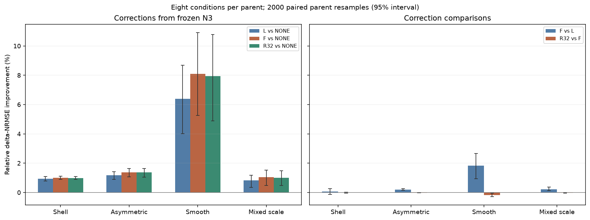

# Maxwell反馈为什么未变成材料成像优势

测量通过材料和内部总场共同决定。显式Maxwell反馈能纠正当前材料假设的内部多次散射，但不会凭空补足测量弱方向里的结构信息。CNN可以先给结构假设，再让物理修正检验其数据一致性；这个顺序是否值得，必须看材料恢复和完整时间。

**结论：数据拟合是主要收益，存在小幅真实材料改善，未达到明显结构成像收益门槛。** N3复杂三家族的一次完整F修正收益 **1.137% [0.923, 1.351]**，相对一次L的额外收益 **0.160% [0.073, 0.240]**；完整数据残差改善 **25.270% [23.657, 26.743]**。本证据接近 **Case B，附“小幅材料收益”限定**，不等同于完全没有材料改善。严格Case A=False，Case C=False。若F/L小差异的区间不含零，不能称它们等效或“F无任何价值”。

## 来源、数据与科学边界

来源固定[A26](https://github.com/migodam/a26-om-feedback-prior-completion/tree/2603f3bd16c48e48587fedc4363975779def17f5)。A25/A26代码、历史gates及训练结果保留。只用16个已经暴露的development parents×八条件；N3主比较、N1辅助。没有训练、生成新标签、打开locked ID/OOD、调整R32 rank或启动非线性重建。物理是known-background二维TM24×24、8源32接收器、完整1152实材料网格；数据标签的增量复相位固定，不能推广到任意复材料或三维矢量成像。

T0核对原A24 SciPy与Torch执行port，forward/adjoint/JVP/实packing等最大缺陷约2e-15；N1/N3的128幅冻结checkpoint预测精确重现。Mac测试168/168通过；XINAN168项、0错误0失败、明确跳过3项缺少Clarabel的旧独立参考。恒等式和tests证明接线，不证明材料优越性。FGP共同数值健康12/12、最终修正1024/1024行有效；旧387失败与中断重跑完整保存。

## 1. exact post-decoder是否有效

| 起点/修正 | Δχ NRMSE | full χ NRMSE | full data residual | IoU | edge F1 | SSIM | 接受/128 |
| --- | --- | --- | --- | --- | --- | --- | --- |
| NONE | 0.603592 | 0.223795 | 0.157983 | 0.628517 | 0.600204 | 0.803954 | 0 |
| L | 0.592221 | 0.222379 | 0.131242 | 0.626688 | 0.593156 | 0.816776 | 125 |
| F | 0.589772 | 0.221414 | 0.115357 | 0.627681 | 0.593019 | 0.833434 | 128 |
| TASK_R32 | 0.590001 | 0.221532 | 0.116835 | 0.628441 | 0.593733 | 0.833617 | 128 |

| 家族 | F vs NONE 材料收益/95%区间 | F vs L 材料收益/95%区间 |
| --- | --- | --- |
| shell | 0.995% [0.888, 1.103] | 0.064% [-0.125, 0.253] |
| asymmetric_piecewise | 1.378% [1.060, 1.633] | 0.199% [0.140, 0.252] |
| smooth | 8.090% [5.266, 10.913] | 1.838% [0.943, 2.663] |
| mixed_scale | 1.039% [0.479, 1.531] | 0.217% [0.139, 0.361] |
| 复杂三家族 | 1.137% [0.923, 1.351] | 0.160% [0.073, 0.240] |
| 全部四家族 | 2.875% [1.425, 4.735] | 0.580% [0.211, 1.028] |

F比L更接近有用的修正方向，但一次后处理仍不足以找回大部分结构误差。N3的IoU/edge没有同步改善到支持复杂边界恢复的程度；data下降/material变差的F条件 **6/128** 全部留在统计里。其余family、Re/Im、fullχ和置信区间见[修正报告](A27_POST_DECODER_CORRECTION.md)。

## 2. 反馈放在哪里、R32丢失什么

| 状态（仅64个20dB条件） | F−L / 噪声 median | ≥1的条件 | R/F梯度cos min | R/F梯度相对误差 median | F/真值误差 alignment median |
| --- | --- | --- | --- | --- | --- |
| COMMON_BP | 0.168546 | 0/64 | 0.999975 | 0.00176349 | 0.535859 |
| ONE_STEP_L | 0.346473 | 11/64 | 0.999919 | 0.00330065 | 0.502583 |
| CNN_N3 | 1.42493 | 36/64 | 0.937057 | 0.0498842 | 0.119464 |
| CNN_N1 | 1.47296 | 42/64 | 0.883955 | 0.0689571 | 0.128075 |
| POST_N3_F | 1.43642 | 35/64 | 0.770897 | 0.103525 | 0.0992717 |

所有64个20dB BP初值的F−L信号均小于噪声；N3预测后36/64、N1后42/64超过噪声。A26冻结encoder计算反馈的位置过早，是支持的瓶颈之一；但把精确F放到CNN后只产生小幅材料收益，因此不是唯一解释。

F梯度与真值误差的offline alignment由BP约0.536降到N3预测约0.119。完整F比L的预测状态alignment更好，但都没有指向大多数残余结构误差。此alignment需要truth，不能用于在线择步。R32在BP非常准确，CNN及post状态梯度失配变大、最小cos可低于旧0.99检查；初值高精度不认证整个学习轨迹。实际R修正图像接近F，并不能反证梯度风险，因为两者都受共同full-F接受和TV约束。

R32不是A26失败的充分解释：A26实际编码的初值处R梯度准确，且完整F后处理同样没有大的复杂材料收益。本项目不再为此调rank。[全部逐状态数据](results/a27/diagnostics/PER_STATE.csv)、[家族均值](results/a27/artifacts_post_fgp/tables/STATE_PARENT_MEANS.csv)。clean无噪声比值标undefined，不加floor让它通过。

实际N3复杂家族R/F修正向量约有10.03%相对差，最终材料NRMSE却很接近。与L/F位移约64.04%相对差并列来看，方向差或传播差不能单独代替结构恢复证据。零拒绝位移导致部分cos定义缺失，原表保留HOLD。

## 3. 剩余误差与梯度的空间错位

| 网络 | 弱方向误差能量 | 强方向真值增量能量 | q强 | q弱 | 背景/预测强空间 overlap | 梯度强方向能量 |
| --- | --- | --- | --- | --- | --- | --- |
| N3 | 0.962156 | 0.624733 | 0.0593654 | 5.04575 | 0.997762 | 0.999735 |
| N1 | 0.958556 | 0.625906 | 0.0625529 | 5.01772 | 0.997569 | 0.999833 |

在32个固定代表预测状态中，N3约96.2%的材料误差属于局部弱方向，而数据梯度约99.97%属于强方向；强方向仍含约62.5%的真值增量能量。背景/预测强空间重叠约0.998。支持“先验/弱空间是当前材料瓶颈”的解释，但不是posterior uncertainty或硬phys/prior分解认证。soft projector交叉项、null补空间和4-parent范围详见[可观测性报告](A27_OBSERVABILITY_AND_PRIOR.md)。

## 4. 有限工程收益及真实代价

| 实际原生计时臂 | median ms | 样本数 |
| --- | --- | --- |
| ORIGINAL_N1 | 45.445 | 48 |
| ORIGINAL_N2 | 99.836 | 48 |
| ORIGINAL_N3 | 40.642 | 48 |
| N2_NO_BETA_ONLY | 86.491 | 48 |
| N2_LU_REUSE_ONLY | 114.493 | 48 |
| N2_COMBINED | 97.693 | 48 |
| POST_NONE | 38.928 | 48 |
| POST_L | 391.038 | 48 |
| POST_F | 259.714 | 48 |
| POST_TASK_R32 | 251.029 | 48 |

beta-only L前向没有进入CNN特征，可以删除并保留安全检查；同会话约13.37%提速，仍比N3慢约2.13倍。LU复用只减少分解数，当前实现总延迟反而上升。一次exact correction约260ms，不是约39ms的BP+CNN同质量提速。阶段事件不能相加、rank不能代替time-to-image，详见[延迟报告](A27_LATENCY_ATTRIBUTION.md)。

## 5. 训练时中间量可行性

已有A25 TRAIN电流足以恢复总场和相对源；256独立clean states的本构/相对恒等式缺陷≤7.14e-14，没有新标签。可设计只在训练出现、部署移除的current/field分支，并约束所有源共享同一材料。效果只是SPEC_ONLY，不预设shell收益。SOM-Net已有current/receiver-data/material losses，内部total-field与material-update-aware项需要公平消融，不能包装成首次物理监督。[最小规格](A27_INTERMEDIATE_SUPERVISION_SPEC.md)。

## 6. A25与A26不能简化成唯一因果

A25正向证据来自特定weak背景/幅度、TV设置和多次更新；A26在弱初值处计算一次冻结编码，并在decoder后没有物理修正。A27改变为单次TV修正及共同full-F接受，目的只是判别瓶颈。不同prior、更新数和接受规则使历史比较无法唯一分离architecture因果。此次不以单次失败杀死所有Maxwell feedback，也不以data下降宣称成像优势。

## 条件决策与下一步

- **Case A：**若完整F在独立材料上显著改善复杂形状，可研究少量物理一致性更新、廉价feedback和current-supervised unrolling。本次冻结明显收益筛选未通过。
- **Case B：**若主要改变数据拟合，优先检验弱方向的结构先验、训练时跨源物理监督与校准不确定性；不能只追求更准确的传播。本次最接近此情形，必须保留小幅材料收益限定。
- **Case C：**若F/L材料收益统计近似相同，停止当前regime中的compression扩展。点差小不等于严格等效；本次严格含零区间条件是否成立由原gate给出，不改阈值。

给GPT Pro的定量设计约束与应保留/训练时学习/删除的计算见[A27_RECOMMENDATION_FOR_GPT_PRO.md](A27_RECOMMENDATION_FOR_GPT_PRO.md)。所有证据为exploratory development，没有自动训练或holdout扩展。科学裁决与网页发布状态分开。

完整原始NPZ/电流谱/动作账本在A27 Release；Git保存CSV、图、配置、源码及失败/terminal receipts。[复现命令](REPRODUCING_A27.md) · [计费报告](A27_COST_AND_RUNTIME.md) · [冻结gate](A27_GATE_DECISION.json)。
