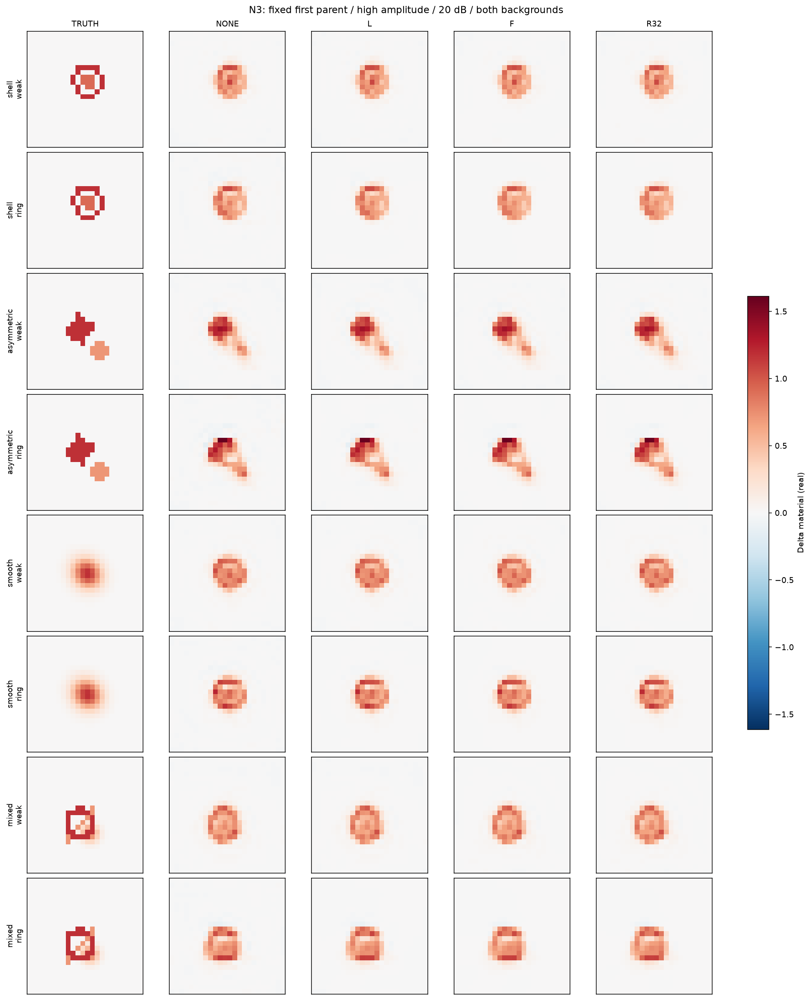

# A27 — Maxwell Feedback Failure Attribution

完整中文研究入口：[A27_START_HERE.md](A27_START_HERE.md) 和 [机制诊断报告](A27_MECHANISM_DIAGNOSIS.md)。

This is an exploratory, exposed-development diagnosis of frozen A26 checkpoints, not another training run. Exact post-decoder feedback improves data fitting far more than material structure. Small positive material effects are retained; no claim of zero feedback value, unique material recovery, or fast deployment is made.

The experiment uses all 16 exposed development parents (128 conditions), N3 as primary and N1 as auxiliary, with NONE/L/full Maxwell F/TASK_R32 corrections. Online acceptance never reads truth. A common numerical-only proximal repair keeps the original objective, constraints and certification thresholds; all earlier failures remain archived.

- [Post-decoder materials, family tables and parent bootstrap](A27_POST_DECODER_CORRECTION.md)
- [Offline observability and prior-bias analysis](A27_OBSERVABILITY_AND_PRIOR.md)
- [Native latency, beta-only omission and LU reuse](A27_LATENCY_ATTRIBUTION.md)
- [Training-only current/field supervision specification — no training](A27_INTERMEDIATE_SUPERVISION_SPEC.md)
- [Quantitative brief for GPT Pro](A27_RECOMMENDATION_FOR_GPT_PRO.md)
- [Frozen A27 decisions](A27_GATE_DECISION.json), [costs](A27_COST_AND_RUNTIME.md), [reproduction](REPRODUCING_A27.md)

Code, configurations, scalar evidence, figures and terminal receipts are in Git. Raw reconstruction/spectral arrays, detailed action ledgers and original failures are in the [A27 release](https://github.com/migodam/a27-feedback-failure-attribution/releases/tag/a27-v0.1.0). The [anonymous GPT brief](https://raw.githubusercontent.com/migodam/a27-feedback-failure-attribution/main/A27_RECOMMENDATION_FOR_GPT_PRO.md) links all supporting evidence.

Physics remains the validated 24×24 **2D scalar TM** backend with known weak/ring backgrounds and fixed relative complex-phase labels. No 3D Vector-Maxwell claim, locked ID/OOD access, new labels, rank search, CNN retraining, VAE/diffusion or new nonlinear reconstruction occurred. Inherited A24–A26 files and their original gate decisions are historical controls, not new A27 evidence. The original root `GATE_DECISION.json` belongs to A26; the A27 decision is explicitly named above.
